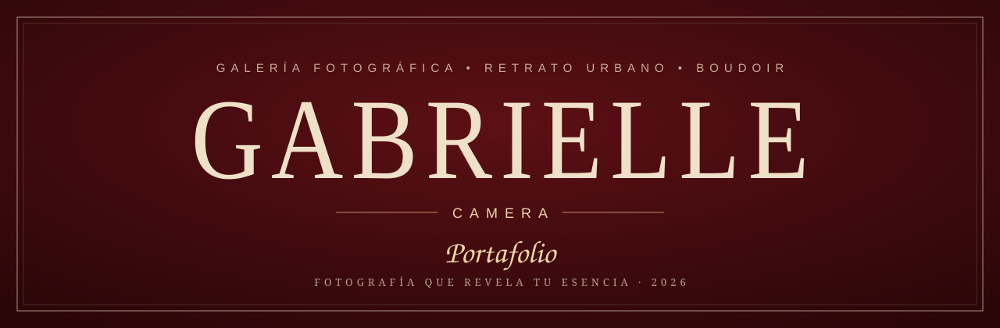
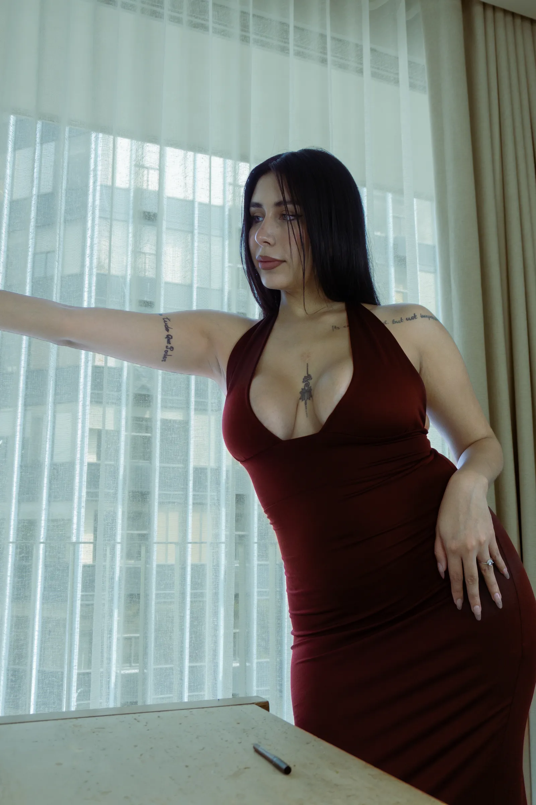
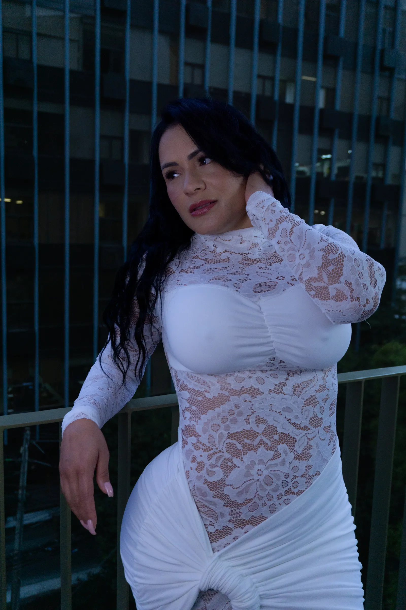
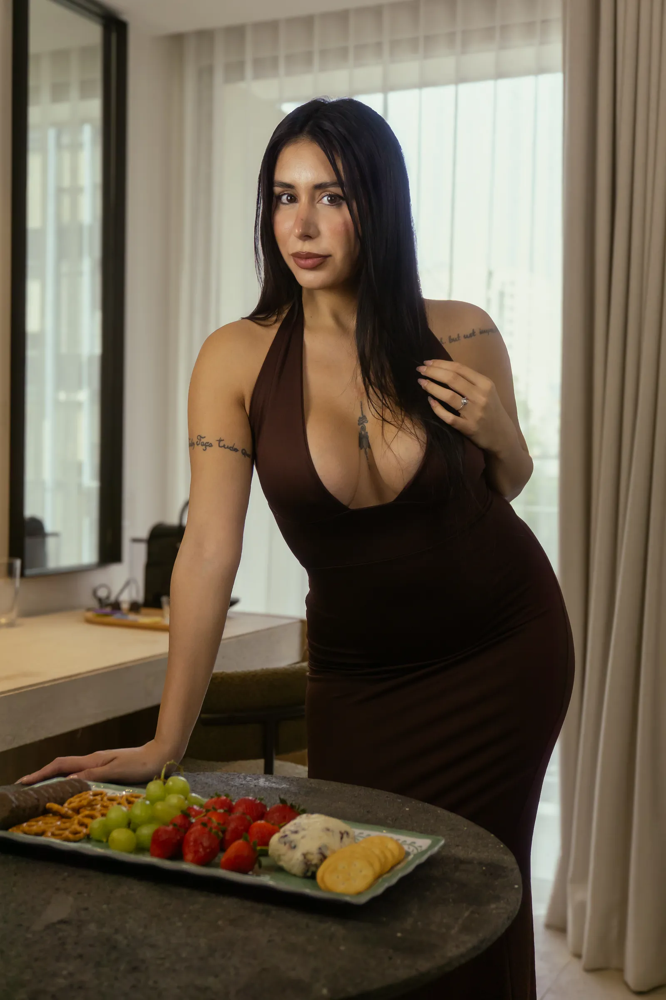
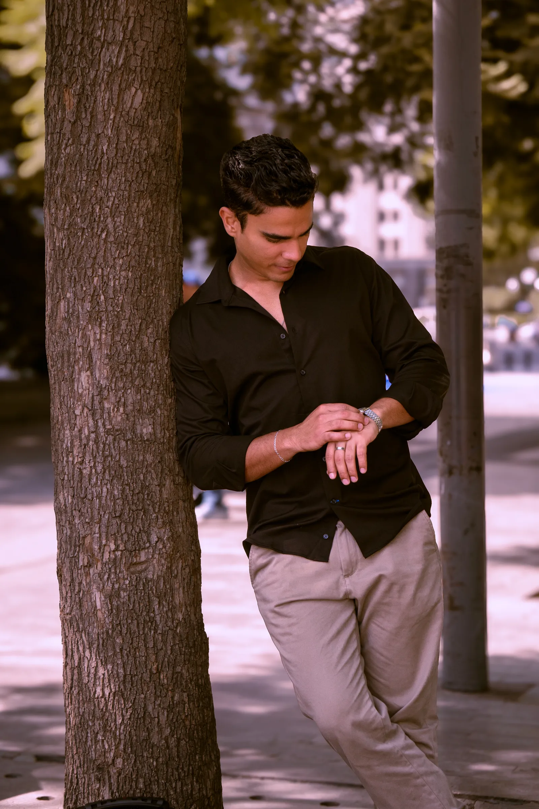
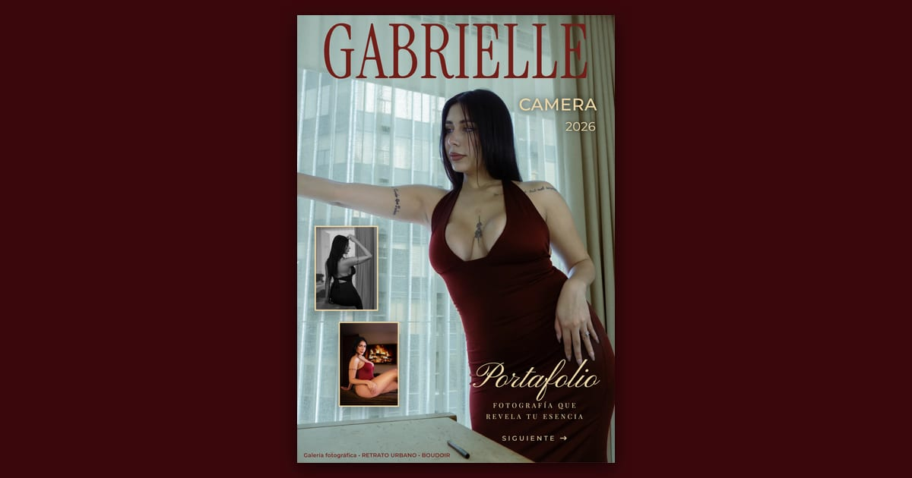

<p align="center">
  
</p>

<p align="center">
  <a href="https://gabriellecamera.netlify.app"></a>
</p>

<p align="center">
  
  
  
  
  
  
  
</p>

<p align="center"><em>Una revista digital que se hojea como papel: 36 páginas de retrato y boudoir,<br>con paquetes y reservación directa por WhatsApp.</em></p>

<p align="center">
  
  
  
  
  
</p>

---

## ✦ Índice

[La revista](#-la-revista) · [Identidad visual](#-identidad-visual) · [Estructura](#-estructura) · [En local](#-en-local) · [Arquitectura](#-arquitectura) · [Precios](#-precios-desde-google-sheets) · [Fotos nuevas](#-fotos-nuevas) · [Vista previa al compartir](#-vista-previa-al-compartir) · [Despliegue](#-despliegue)

---

## ✦ La revista

| Págs. | Sección | Detalle |
|:---:|---|---|
| **01** | Portada | Collage con foto a sangre y botón **SIGUIENTE** |
| **02 · 03** | Intros | Boudoir y Retrato, con rango de precios y **Ver paquetes** |
| **04 – 19** | Galería Boudoir | Collages según los bocetos de la clienta |
| **20 – 26** | Retrato femenino | Collages según los bocetos de la clienta |
| **27 – 33** | Retrato masculino | Diseño editorial propio |
| **34 · 35** | Paquetes y precios | Retrato · Boudoir, frente a frente en el mismo pliego |
| **36** | Contraportada | WhatsApp, Instagram y correo |

Doble página en escritorio (≥ 768 px) y una sola página en proporción A4 en móvil. Se hojea con botones, flechas del teclado o arrastrando la esquina, con sonido de papel.

---

## ✦ Identidad visual

<table>
  <tr>
    <td><b>Paleta</b></td>
    <td>
       vino &nbsp;
       tinta &nbsp;
       vino claro &nbsp;
       título &nbsp;
       papel &nbsp;
       crema &nbsp;
       carbón &nbsp;
       taupe
    </td>
  </tr>
  <tr>
    <td><b>Tipografía</b></td>
    <td>
      <b>Playfair Display</b> títulos · <b>Instrument Serif</b> display · <i>Pinyon Script</i> firma ·
      <b>Montserrat</b> texto · <code>Courier Prime</code> galerías
    </td>
  </tr>
</table>

Todos los colores y fuentes viven como variables en `:root` de `css/styles.css`.

---

## ✦ Estructura

```text
PortafolioFotografia/
├── portafolioweb/                  ← este repositorio (lo que se publica)
│   ├── index.html                  las 36 páginas dentro de #magazine
│   ├── css/styles.css              estilos y variables de la marca
│   ├── js/script.js                turn.js, layout, navegación, sonido y precios
│   ├── assets/
│   │   ├── images/<sesión>/        fotos en .webp
│   │   ├── images/og-cover.jpg     vista previa al compartir (1200×630)
│   │   ├── favicon.svg · .png
│   │   └── audio/page-flip.mp3
│   └── docs/portada.svg            portada de este README
├── herramientas/                   scripts de Node (fuera del repo)
│   ├── optimizar.js
│   └── generar-iconos.js
└── respaldo-imagenes-originales/   originales antes de optimizar (fuera del repo)
```

---

## ✦ En local

No hay dependencias ni build. Basta servir la carpeta:

```bash
cd portafolioweb
python -m http.server 8000
# → http://localhost:8000
```

> [!NOTE]
> Abrir `index.html` con doble clic también funciona, pero con `file://` el navegador bloquea la hoja de Google y se ven los precios de respaldo escritos en el HTML.

---

## ✦ Arquitectura

**Escalado en `em`.** `script.js` calcula el tamaño de página según la ventana y fija el `font-size` de `#magazine`; todo lo de adentro mide en `em`, así la revista escala completa.

**turn.js y el envoltorio.** turn.js mide sin padding, así que `script.js` envuelve cada `.page` en un `.page-sheet` y le añade las clases `.odd/.even` y su barra de navegación. Nada de eso se escribe a mano.

**Collages.** Fotos (`.bd-photo`) y textos (`.bd-word`) van en posición absoluta con porcentajes de la página, para que el acomodo se mantenga en doble página y en móvil. Las clases `.bd-NN` / `.rt-0N` siguen el número de boceto de la clienta, no el de página.

**Regla de pliegos.** Los precios deben quedar frente a frente: Retrato en página **par**, Boudoir en **impar**.

> [!IMPORTANT]
> Si se agregan o quitan páginas antes de los precios, el total añadido debe ser **par** (o compensarse con otra página). Después, actualizar los `data-goto` de **Ver paquetes** y **Continuar viendo galería**. `script.js` encuentra los precios por la clase `.page-prices`, no por número.

**Navegación con `paginaOrigen`.** Guarda la intro desde la que se abrieron los precios. Mientras existe, Volver y Siguiente se mueven una página desde esa intro (desde la 03 → 02 / 04; desde la 02 → portada / 03). Se borra al usarse, con **Continuar viendo galería** o al salir de los precios por cualquier otro camino.

---

## ✦ Precios desde Google Sheets

La clienta cambia sus precios en una hoja de Google publicada como CSV; la URL está en `GOOGLE_SHEET_CSV_URL`, al inicio de `script.js`.

| id | categoria | paquete | precio |
|---|---|---|---|
| `retrato_basico` | retrato | Básico | `$440` |
| `retrato_extendido` | retrato | Extendido | … |
| `retrato_completo` | retrato | Completo | … |
| `boudoir_basico` | boudoir | Básico | … |
| `boudoir_extendido` | boudoir | Extendido | … |

- Los `id` corresponden al atributo `data-precio-id` del HTML; las intros muestran el rango mín.–máx. de su categoría (`data-rango-categoria`).
- El precio acepta `440`, `$440`, `$440 MXN` o `$1,200` y siempre se muestra como **$X MXN**.
- Si la hoja falla o una fila no se entiende, se quedan los precios escritos en el HTML.
- Las referencias del DOM se guardan **antes** de iniciar turn.js, porque este saca del DOM las páginas lejanas.
- Google tarda unos 5 minutos en reflejar los cambios.

---

## ✦ Fotos nuevas

```bash
# 1. Respaldar los originales en respaldo-imagenes-originales/
# 2. Copiarlos a portafolioweb/assets/images/<sesión>/
cd herramientas
npm install            # solo la primera vez (sharp)
node optimizar.js      # JPG/PNG → WebP · máx. 1600 px · calidad 80
# 3. Usar el .webp en index.html
```

> [!WARNING]
> `optimizar.js` **borra** cada JPG/PNG después de convertirlo. Respaldar siempre antes.

---

## ✦ Vista previa al compartir

```bash
node generar-iconos.js              # favicon.svg + favicon.png (180×180)
node generar-iconos.js portada.png  # + og-cover.jpg (1200×630, < 300 KB)
```

La captura de la portada se toma en el navegador a **600×900** con `deviceScaleFactor` 2, recortando `.page-cover`. Rehacerla si cambia la portada. `og-cover.jpg` debe seguir en JPG porque WhatsApp y Messenger no muestran WebP.

<p align="center"></p>

---

## ✦ Despliegue

Netlify está conectado a este repositorio: **cada push a `main` se publica** en
[gabriellecamera.netlify.app](https://gabriellecamera.netlify.app). No hay comando de build; se sirve la raíz del repo.

> [!TIP]
> Si cambia el dominio, actualizar en el `<head>` de `index.html` las URL absolutas de `og:url`, `og:image` y `twitter:image`.

---

<p align="center">
  <sub><b>GABRIELLE CAMERA</b> · Fotografía que revela tu esencia · 2026</sub><br>
  <sub><a href="https://www.instagram.com/gabrielle_camera/">@gabrielle_camera</a></sub>
</p>
